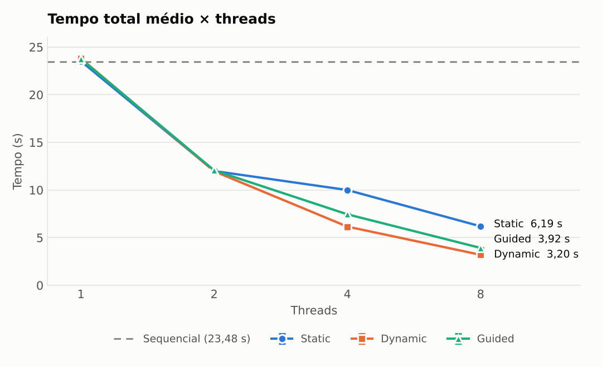
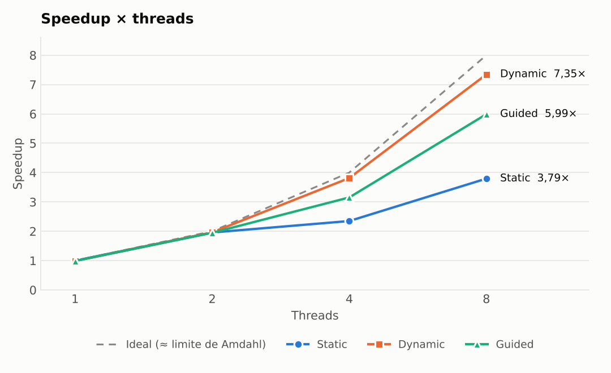
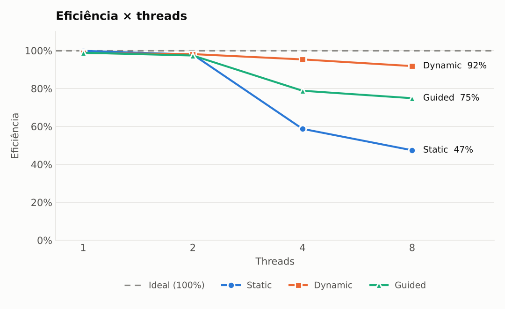

# Paralelização do Conjunto de Mandelbrot com OpenMP

Grupo:
- Cauê de Almeida Gonçalves
- Kayke Guilherme Vertu
- Thais Larriane Guimarães Barbosa

Aplicação: <https://github.com/hpc-fci-mackenzie/mpp/blob/master/17/mandelbrot.zip>

## Compilação e execução

### Compilação

Para compilar, use o makefile providenciado:

```sh
make # Gera todos os executáveis
make original # Código original inalterado
make seq # Código original, mas com temporizadores para fazer a análise
make static # Paralelizado (distribuição estática)
make dynamic # Paralelizado (distribuição dinâmica)
make guided # Paralelizado (distribuição guiada)
```
  
### Execução

Ao compilar, você pode chamar o programa passando os valores de entrada da forma como preferir. Segue um exemplo com o código sequencial:

```sh
cat mandelbrot.in | ./seq
```

Para facilitar os testes e geração dos resultados, foi criado um script shell básico para fazer execuções em massa:

```sh
# Uso: ./executar.sh [arquivo de saída] [nº de execuções] [comando]
./executar.sh seq.csv 5 "cat mandelbrot.in | ./seq" # Usar aspas aqui é recomendado
```

Para fazer a comparação entre diferentes números de threads, foi alterado a constante OMP_NUM_THREADS, conforme exemplo a seguir

```sh
# Executa o código paralelizado estático com duas threads
./executar.sh static2threads.csv 5 "cat mandelbrot.in | OMP_NUM_THREADS=2 ./static"
```

## Descrição do problema e análise do código sequencial
O programa irá gerar uma imagem em texto do conjunto de Mandelbrot, ele é formado pelos números complexos c para os quais a sequência z = z² + c não diverge.

Cada pixel da imagem (230 linhas × 790 colunas) representa um ponto do plano complexo. O programa executa a fórmula até z passar de 2 ou até atingir 24.000 iterações. Pontos do conjunto são marcados com "#", e os demais com "."

O código tem três etapas: leitura da entrada e alocação da matriz, cálculo de todos os pixels e escrita da matriz na saída. Medindo cada etapa separadamente, o cálculo ocupa 99,995% do tempo total 23,48 s, enquanto a leitura e a escrita juntas levam menos de 1,1 ms. O custo computacional está, portanto, quase todo no laço de cálculo.

A leitura e a escrita são descartáveis. Os pixels são independentes entre si, o que deixa possível paralelizar o cálculo. Porém, as iterações de um mesmo pixel são sequenciais, já que os valores dependem dos anteriores. O custo por pixel varia muito: cerca de 68.483 dos 181.700 pixels (38%) dos pixels pertencem ao conjunto e executam as 24.000 iterações, enquanto os demais terminam em poucas iterações. Esses pixels custosos estão nas linhas centrais, causando desbalanceamento de carga entre as threads.

## Estratégia de paralelização

O trabalho foi dividido por linhas da imagem. O laço externo, que percorre as linhas, foi paralelizado com OpenMP, de modo que cada thread calcula um conjunto de linhas completas:

```c
#pragma omp parallel for schedule(static ou guided ou dynamic)
for (int r = 0; r < max_row; ++r) {
    for (int c = 0; c < max_column; ++c) {
        // cálculo do pixel (r, c), igual ao código sequencial
    }
}
```

Como dito anteriormente do laço externo cada pixel é calculado de forma independente: o resultado de um pixel não depende do outro. Em contrapartida O laço while, que faz as iterações de cada pixel, não pode ser paralelizado, porque cada novo valor de z depende do valor anterior.

Não há condição de corrida no cálculo. Pois, cada thread escreve nas posições da matriz que das suas linhas, e nenhuma thread lê o que outra escreveu. Por isso, não foi necessário nenhum lock.

As variáveis declaradas dentro do laço (c, z e n) são privadas de cada thread. A matriz mat e os parâmetros da entrada (max_row, max_column e max_n) são compartilhados.

Como visto em aula no nosso projeto a única sincronização é a barreira implícita no fim do parallel for: o programa espera todas as threads terminarem antes de escrever a imagem na saída.

O custo das linhas é muito desigual: as linhas centrais contêm a maior parte dos pontos do conjunto, que executam as 24.000 iterações, enquanto as linhas das bordas terminam rápido. Por este motivo, a forma de dividir as linhas entre as threads tem grande impacto no desempenho.

Foi usado para fins de relatório e estudo:
  - `schedule(static)`: divide as linhas em blocos contíguos, um por thread. As threads que recebem as linhas centrais ficam com quase todo o trabalho, e as outras terminam cedo e ficam ociosas.

  - `schedule(static, 1)`: distribui as linhas de forma intercalada (linha 0 para a thread 0, linha 1 para a thread 1, e assim por diante). As linhas caras ficam espalhadas entre todas as threads, sem custo extra de escalonamento.

  - `schedule(dynamic, [chunk])`: cada thread pega um novo bloco de linhas quando termina o anterior. Adapta-se ao custo real de cada linha, com um pequeno custo de escalonamento.

  - `schedule(guided)`: semelhante ao dynamic, mas começa com blocos grandes e diminui o tamanho ao longo da execução.


E analisando escolhemos [inserir aqui]

## Ambiente de testes

- CPU: AMD Ryzen 9 5900X
- Núcleos: 12
- Memória: 16GB
- Sistema operacional: CachyOS x86_64
- Compilador: GCC 16.2.1
- Flags: `-O3 -std=c++11 -fopenmp`

## Metodologia

**Entrada:** `mandelbrot.in`, a entrada fornecida com o problema: 230 linhas, 790 colunas e no máximo 24.000 iterações por pixel.

**Execuções:** cada configuração foi executada **5 vezes**. Foram medidas a versão sequencial e as três versões paralelas com 1, 2, 4 e 8 threads, num total de 65 execuções. Cada execução é um processo independente.

**Medição:** o tempo de cada etapa (leitura, cálculo e escrita) foi medido dentro do programa com `std::chrono::steady_clock`. O tempo de cálculo das versões paralelas inclui a criação das threads, já que o laço de cálculo é a primeira região paralela do programa. Todas as execuções foram feitas na mesma máquina, e a imagem gerada por cada versão foi comparada com a do código original usando `diff`.

**Estatística:** para cada configuração, foram calculados a média e o desvio padrão amostral das 5 execuções, na planilha `resultados_mandelbrot.xlsx`. A variação foi: o coeficiente de variação (desvio ÷ média) ficou em 0,15% no sequencial e abaixo de 1,1% em todas as configurações paralelas.

**Métricas:**

- Speedup: *S(p) = T_seq ÷ T(p)*, usando o tempo total médio.
- Eficiência: *E(p) = S(p) ÷ p*.

## Resultados

**Versão sequencial** (média ± desvio padrão de 5 execuções):

| Etapa | Tempo (s) | % do total |
|---|---:|---:|
| Leitura | 0,000074 ± 0,000007 | 0,0003% |
| Cálculo | 23,4808 ± 0,0354 | 99,9952% |
| Escrita | 0,0011 ± 0,00003 | 0,0045% |
| **Total** | **23,4819 ± 0,0354** | 100% |

**Tempo total médio das versões paralelas** (s, média ± desvio padrão de 5 execuções):

| Threads | Static | Dynamic | Guided |
|---:|---:|---:|---:|
| 1 | 23,517 ± 0,021 | 23,804 ± 0,048 | 23,754 ± 0,095 |
| 2 | 11,993 ± 0,067 | 11,964 ± 0,057 | 12,056 ± 0,017 |
| 4 | 9,997 ± 0,026 | 6,158 ± 0,010 | 7,448 ± 0,081 |
| 8 | 6,189 ± 0,019 | 3,197 ± 0,020 | 3,920 ± 0,040 |

**Speedup e eficiência:**

| Threads | Speedup Static | Speedup Dynamic | Speedup Guided | Eficiência Static | Eficiência Dynamic | Eficiência Guided |
|---:|---:|---:|---:|---:|---:|---:|
| 1 | 1,00 | 0,99 | 0,99 | 99,9% | 98,6% | 98,9% |
| 2 | 1,96 | 1,96 | 1,95 | 97,9% | 98,1% | 97,4% |
| 4 | 2,35 | 3,81 | 3,15 | 58,7% | 95,3% | 78,8% |
| 8 | 3,79 | **7,35** | 5,99 | 47,4% | **91,8%** | 74,9% |







No gráfico de tempo, as barras de desvio padrão existem, mas são pequenas para aparecer na escala (menos de 0,1 s).

Todos os dados estão na planilha resultados_mandelbrot.xlsx


## Discussão dos resultados e limitações

**Lei de Amdahl:** a fração sequencial do programa (leitura e escrita) é de apenas 0,0048% do tempo total. Pela Lei de Amdahl, o speedup máximo teórico com 8 threads seria de 7,997. Ou seja, a parte sequencial não é limitante neste problema, e a perda de desempenho observada vem de como o trabalho é dividido entre as threads.

**Comparação entre as estratégias:** o `dynamic` foi a melhor estratégia, com speedup de 7,35 e eficiência de 92% com 8 threads. O `static` foi a pior, com speedup de 3,79 e eficiência de 47%. A diferença vem do desbalanceamento de carga:

- Com `static`, cada thread recebe um bloco contíguo de linhas. Com 4 e 8 threads, as threads que recebem as linhas centrais ficam com quase todo o trabalho, enquanto as das bordas terminam cedo e ficam ociosas. Com 4 threads, o speedup foi de apenas 2,35.
- Com `dynamic, 1`, as threads pegam uma linha por vez e as linhas caras se espalham entre todas, o que mantém a carga equilibrada mesmo com 8 threads.
- O `guided` ficou no meio (5,99 com 8 threads). Ele começa distribuindo blocos grandes, e um desses blocos pode concentrar a região central da imagem. Os blocos pequenos do final não são suficientes para compensar esse desequilíbrio inicial.

**Overhead:** com 1 thread, as versões paralelas foram um pouco mais lentas que a sequencial: 0,15% no `static`, 1,37% no `dynamic` e 1,16% no `guided`. Essas estratégias distribuem as linhas durante a execução, o que tem um custo, mas 230 distribuições não deveriam custar 0,3 s como visto nos relatórios. Parte da diferença pode vir do código gerado pelo compilador para a região paralela ou de variações de frequência do processador, e com os testes realizados não conseguimos isolar a causa. Porém, o overhead de criar as threads é pequeno comparado aos segundos de cálculo.

**Limitações:**

- Os testes foram até 8 threads.
- Foi usada uma única entrada. Não foi testado como o desempenho muda com imagens maiores ou com mais iterações.
- A leitura e a escrita não foram paralelizadas, mas juntas representam menos de 0,005% do tempo.
- O cálculo foi mantido igual ao original para uma comparação justa.

## Contribuição de cada membro

- Cauê de Almeida Gonçalves: Adicionado o temporizador no código sequencial e em paralelo e README
- Kayke Guilherme Vertu: Criação do script shell e execução dos testes
- [Nome 3]: [ ]

## Uso de LLM

### Planilha Excel

Foi solicitado ao claude gerar a planilha para analise do código e gerar os relatórios para os gráficos.

### Dúvidas de montagem do README

Foi solicitado ao Claude como montar tabelas e inserir imagens no README

**Prompt utilizado**

- Quero um excel para preencher dados de execuções de um código sequencial e em paralelo será executado 5 vezes e com 1, 2, 4, 8 threads. 
Deverá conter os seguintes calculos: tempo/speedup/eficiência.
- Como inserir imagens no Read.me
- Como inserir dados em tabelas no Read.me

### Dúvidas na criação do script shell

Foi solicitado ao ChatGPT um exemplo simples de um script shell que fizesse várias execuções de um único programa e guardasse o resultado em um arquivo. A partir do exemplo providenciado pela IA, o código foi extensivamente modificado para atender as nossas necessidades.

**Prompt utilizado:** Crie um script shell que execute um programa pelo terminal e salve o output em um arquivo. Permita que eu passe por parâmetro a quantidade de vezes que tem que ser executado
